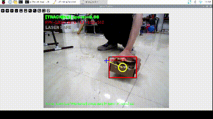
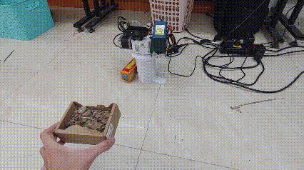

# WeedLaser Demo

An AI-powered weed-killing demo system. A USB webcam feeds a TensorFlow Lite
object-detection model (accelerated by a Google Coral Edge TPU) running on a
Raspberry Pi 5. When a weed is detected, a pan/tilt turret driven by two stepper
motors aims at the target and a laser burns it.

This is a demonstration project intended for controlled, supervised testing only.

## Demo





## How it works

1. The USB webcam streams frames into OpenCV.
2. Each frame is run through a TFLite weed-detection model on the Coral Edge TPU.
3. The detection nearest the frame center is selected as the target.
4. A proportional controller moves the PAN and TILT stepper axes to center the
   target under the crosshair.
5. Once the target stays inside the aim deadzone continuously for a short lock
   time, the laser fires for a fixed duration.

The main application is
[`tracking.py`](tensorflow-lite-bullseye-main/examples/lite/examples/object_detection/raspberry_pi/tracking.py).

## Hardware

- Raspberry Pi 5
- microSD card
- USB webcam
- Google Coral USB Accelerator (Edge TPU)
- 2 x TMC2209 stepper drivers
- 2 x NEMA 17 two-phase stepper motors (PAN and TILT axes)
- 12 W / 12 V laser module

### 3D-printed parts

STL files for the mechanical build are available here:
https://makerworld.com/models/2743141?appSharePlatform=copy

### GPIO wiring (BCM numbering)

Defined at the top of `tracking.py`:

| Function   | EN | DIR | STEP |
|------------|----|-----|------|
| PAN axis   | 21 | 20  | 16   |
| TILT axis  | 13 | 26  | 19   |

Laser: PWM on GPIO 18 (1 kHz, default 50% power, 5 s per shot).

## Setup: training and Coral Edge TPU

The model training workflow and the Coral Edge TPU setup are documented in a
separate repository. Follow it to prepare the Raspberry Pi, install the Edge TPU
runtime, and train / export the `.tflite` model:

https://github.com/Datnewlevel/Pi5_object_detection_with_coral.git

The trained models used by this demo (`grass_v3.tflite`, `grass_v2.tflite`,
`best_grass.tflite`) live alongside `tracking.py`.

## Running

After the setup above is complete, run these four commands:

```bash
cd freedomtech

source .venv/bin/activate

cd /home/pi/freedomtech/tensorflow-lite-bullseye-main/examples/lite/examples/object_detection/raspberry_pi

python tracking.py --model grass_v3.tflite --enableEdgeTPU
```

An OpenCV window opens showing the camera feed, detections, and turret status.

## Controls

The turret is controlled from the OpenCV window using the keyboard:

| Key       | Action                                                         |
|-----------|----------------------------------------------------------------|
| T         | Toggle AI tracking on/off                                      |
| L         | Arm / disarm the laser (safety lock)                           |
| A / D     | Manual pan left / right (tracking off only)                    |
| W / S     | Manual tilt up / down (tracking off only)                      |
| Space     | Emergency stop: cancel current target and turn the laser off   |
| H         | Return both axes to the home (center) position                 |
| + / -     | Increase / decrease the detection score threshold (step 0.05)  |
| ESC       | Exit                                                           |

## Safety

- The laser boots in the DISARMED state and must be armed manually with `L`.
- While armed the laser only fires when a target is locked inside the deadzone.
- Disarming, disabling tracking, or pressing Space immediately turns the laser off.
- On exit the program turns the laser off first, then homes and releases the motors.
- A 12 W laser is dangerous. Always wear appropriate eye protection, keep the
  work area clear, and never leave the system running unattended.
