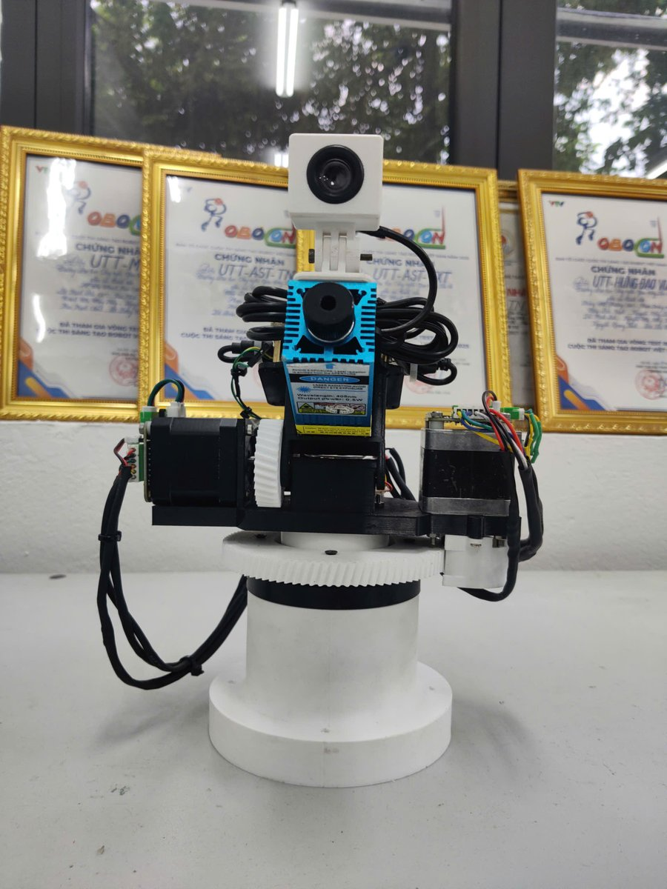
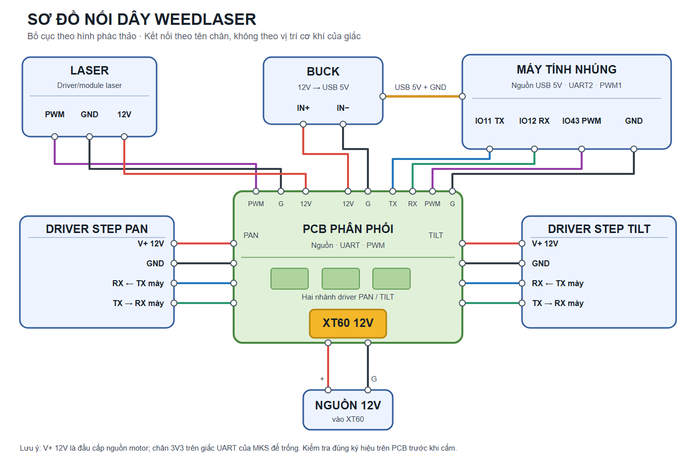

# WeedLaser Demo

An AI-powered weed-killing demo system: a camera finds weeds, a pan/tilt turret
aims a laser at the target, and the laser burns it.

This is a demonstration project intended for controlled, supervised testing only.

---

## Latest version — v2 on CanMV K230



v2 moves the whole system from a Raspberry Pi 5 + Coral Edge TPU onto a single
**CanMV K230** board. Detection runs on the K230's built-in NPU, and the turret
uses **closed-loop** stepper drivers controlled over UART.

> **Status — read before powering on.** In the current build the TILT axis has
> **no software travel limit and no end-stop detection**. If the target is
> outside the turret's reach, TILT can keep pushing against its mechanical stop.
> At the last journal entry (7 Oct 2026) this build had not yet been verified on
> hardware. Run it only under supervision, with the laser power disconnected
> during tests and someone ready to cut motor power, until hardware limit
> switches are fitted.

### What changed from v1

| | v1 | v2 |
|---|---|---|
| Controller | Raspberry Pi 5 | CanMV K230 mini (01Studio) |
| AI accelerator | Google Coral USB (Edge TPU) | K230 built-in NPU |
| Model | TFLite | YOLO11, 320×320 `.kmodel` |
| Stepper drivers | 2 × TMC2209 (STEP/DIR, open loop) | 2 × MKS SERVO42C (UART, closed loop) |
| Laser | 12 W / 12 V | 405 nm, 0.5 W, Class 3B (per module label) |
| Display | OpenCV window on a monitor | ST7701 MIPI LCD on the board |
| Start-up | launched from a terminal | runs automatically from the SD card |

### How it works

1. A USB webcam streams 640×480 MJPEG frames to the K230.
2. A YOLO11 detector (320×320 input) runs on the K230 NPU.
3. A noise filter rejects weak or jumping detections: a box must score at least
   0.65, be seen in 3 of the last 5 frames, and stay inside a 120 px gating
   window around the tracked target.
4. A proportional controller with braking drives PAN and TILT until the target
   sits inside the aim deadzone (25 px horizontal, 30 px vertical).
5. Once the target has stayed inside the deadzone for 3.5 s and its average
   confidence over 5 frames is at least 0.75, the laser fires at 100% for 15 s,
   then rests for 5 s. Both axes are held still while the laser is firing.
6. Every frame is logged as CSV to `/sdcard/run_log.txt` for offline analysis.

The application is
[`k230_test/main_autorun_full.py`](k230_test/main_autorun_full.py), copied to the
SD card as `main.py`.

### Hardware

- CanMV K230 mini (01Studio)
- ST7701 MIPI LCD
- USB webcam
- 2 × NEMA 17 stepper motors with **MKS SERVO42C** closed-loop drivers
- Laser module: 405 nm, 0.5 W, Class 3B (per the label on the module)
- Measured gear ratios (motor : axis): PAN ≈ 6.3 : 1, TILT ≈ 4 : 1

### Wiring



A 12 V supply enters the distribution PCB through an XT60 connector and feeds
both stepper drivers and the laser. A buck converter turns 12 V into 5 V USB
power for the K230. The 3V3 pin on each MKS UART connector is left unconnected.

| Function | K230 pin | Notes |
|---|---|---|
| UART2 TX | IO11 | shared by both drivers |
| UART2 RX | IO12 | shared by both drivers |
| Laser PWM | IO43 | PWM channel 1, 1 kHz |

Both drivers sit on one UART bus at 115200 baud and are told apart by address:
PAN = `0xE1`, TILT = `0xE2`.

### MKS SERVO42C settings

Set these in each driver's on-board menu. They must be set again after a factory
reset.

| Menu item | Value | Factory default |
|---|---|---|
| `Mode` | `CR_UART` | `CR_vFOC` |
| `UartBaud` | `115200` | — |
| `UartAddr` | PAN `0xE1`, TILT `0xE2` | `0xE0` |
| `MStep` | **64** | 16 |
| `En` | `Hold` | `L` |
| `Protect` | `Disable` | `Disable` |

> `MStep` must be set to 64 before the turret is powered. At the factory default
> of 16, every speed command runs 4× faster. Do not enable `Protect` on TILT: on
> a locked rotor it releases the motor, and TILT would drop under gravity.

### Running

1. Flash CanMV K230 firmware v1.8 (nncase 2.11.0) onto the board.
2. Copy to the SD card:
   - `k230_test/main_autorun_full.py` → `/sdcard/main.py`
   - the model → `/sdcard/best_grass_320.kmodel`
3. Configure both drivers as in the table above.
4. **Centre PAN by hand with the power off.** The PAN angle is counted from the
   power-on position and limited to ±180° of real rotation from there.
5. Power on. The program starts by itself; the laser arms 10 s after boot.

### Known limitations

- **TILT has no travel protection** in the current build (see the status note).
- Both drivers share one UART line on which every device also hears its own
  transmissions. Reading the motor encoders on this bus corrupts the drivers'
  command parsing, so the encoders are never read and axis angles are estimated
  from the commands sent. The next PCB revision is planned to give each driver
  its own K230 UART.
- The deployed model `best_grass_320.kmodel` is a test model trained on a printed
  tag, not on weeds. The weed model `best_weed_320.kmodel` exists, but its
  confidence thresholds have not been tuned yet.

### Safety (v2)

- Unlike v1, the laser is **armed by default** and fires automatically, starting
  10 s after boot, whenever a target is locked. Disconnect laser power whenever
  you are not intentionally testing it.
- A 405 nm Class 3B laser can injure the eye through the direct or reflected
  beam. Wear eye protection rated for 405 nm and keep the area clear.
- Never leave the turret running unattended.

---

## Previous version — v1 on Raspberry Pi 5 + Coral

A USB webcam feeds a TensorFlow Lite object-detection model (accelerated by a
Google Coral Edge TPU) running on a Raspberry Pi 5. When a weed is detected, a
pan/tilt turret driven by two stepper motors aims at the target and a laser
burns it.

### Demo (v1)


### How it works

1. The USB webcam streams frames into OpenCV.
2. Each frame is run through a TFLite weed-detection model on the Coral Edge TPU.
3. The detection nearest the frame center is selected as the target.
4. A proportional controller moves the PAN and TILT stepper axes to center the
   target under the crosshair.
5. Once the target stays inside the aim deadzone continuously for a short lock
   time, the laser fires for a fixed duration.

The main application is
[`tracking.py`](tensorflow-lite-bullseye-main/examples/lite/examples/object_detection/raspberry_pi/tracking.py).

### Hardware

- Raspberry Pi 5
- microSD card
- USB webcam
- Google Coral USB Accelerator (Edge TPU)
- 2 x TMC2209 stepper drivers
- 2 x NEMA 17 two-phase stepper motors (PAN and TILT axes)
- 12 W / 12 V laser module

#### 3D-printed parts

STL files for the mechanical build are available here:
https://makerworld.com/models/2743141?appSharePlatform=copy

#### GPIO wiring (BCM numbering)

Defined at the top of `tracking.py`:

| Function   | EN | DIR | STEP |
|------------|----|-----|------|
| PAN axis   | 21 | 20  | 16   |
| TILT axis  | 13 | 26  | 19   |

Laser: PWM on GPIO 18 (1 kHz, default 50% power, 5 s per shot).

### Setup: training and Coral Edge TPU

The model training workflow and the Coral Edge TPU setup are documented in a
separate repository. Follow it to prepare the Raspberry Pi, install the Edge TPU
runtime, and train / export the `.tflite` model:

https://github.com/Datnewlevel/Pi5_object_detection_with_coral.git

The trained models used by this demo (`grass_v3.tflite`, `grass_v2.tflite`,
`best_grass.tflite`) live alongside `tracking.py`.

### Running

After the setup above is complete, run these four commands:

```bash
cd freedomtech

source .venv/bin/activate

cd /home/pi/freedomtech/tensorflow-lite-bullseye-main/examples/lite/examples/object_detection/raspberry_pi

python tracking.py --model grass_v3.tflite --enableEdgeTPU
```

An OpenCV window opens showing the camera feed, detections, and turret status.

### Controls

The turret is controlled from the OpenCV window using the keyboard:

| Key       | Action                                                         |
|-----------|----------------------------------------------------------------|
| T         | Toggle AI tracking on/off                                      |
| L         | Arm / disarm the laser (safety lock)                           |
| A / D     | Manual pan left / right (tracking off only)                    |
| W / S     | Manual tilt up / down (tracking off only)                      |
| Space     | Emergency stop: cancel current target and turn the laser off   |
| H         | Return both axes to the home (center) position                 |
| + / -     | Increase / decrease the detection score threshold (step 0.05)  |
| ESC       | Exit                                                           |

### Safety

- The laser boots in the DISARMED state and must be armed manually with `L`.
- While armed the laser only fires when a target is locked inside the deadzone.
- Disarming, disabling tracking, or pressing Space immediately turns the laser off.
- On exit the program turns the laser off first, then homes and releases the motors.
- A 12 W laser is dangerous. Always wear appropriate eye protection, keep the
  work area clear, and never leave the system running unattended.
